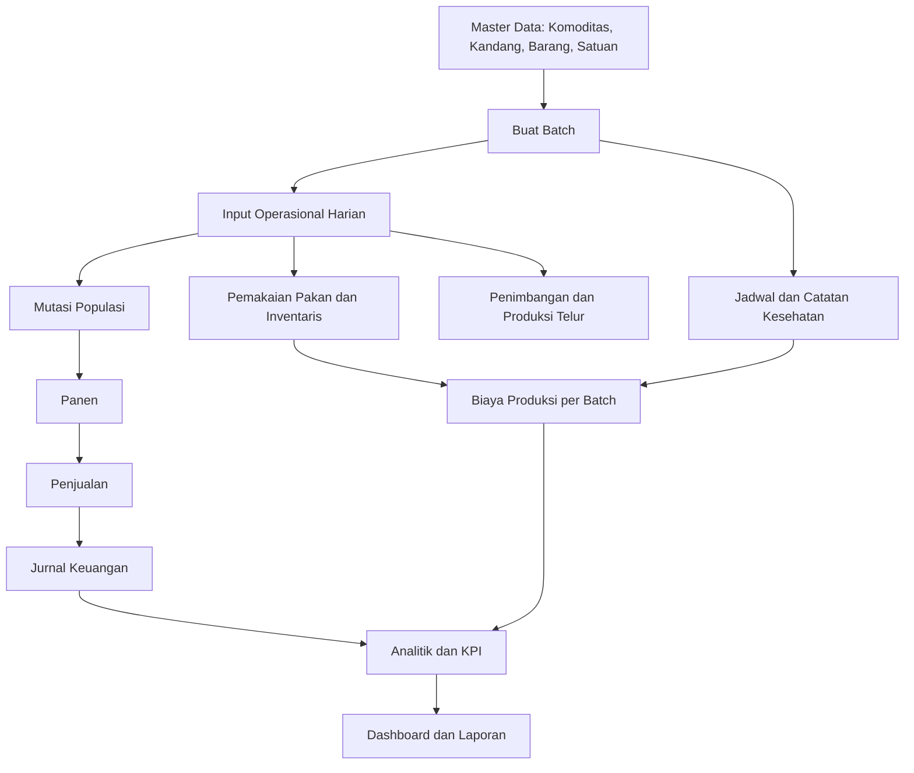
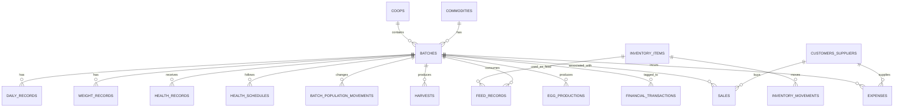

# Rancangan Implementasi Sistem Informasi Manajemen Peternakan Ayam

> **Dokumen gabungan dan spesifikasi teknis untuk pengembangan aplikasi Laravel**  
> Komoditas: **Broiler, Pejantan, dan Layer**  
> Versi dokumen: 1.0  
> Bahasa aplikasi: Indonesia  
> Mata uang utama: Rupiah (IDR)

---

## Daftar Isi

1. [Tentang Dokumen](#1-tentang-dokumen)
2. [Gambaran Umum Sistem](#2-gambaran-umum-sistem)
3. [Tujuan, Ruang Lingkup, dan Pengguna](#3-tujuan-ruang-lingkup-dan-pengguna)
4. [Teknologi yang Digunakan](#4-teknologi-yang-digunakan)
5. [Struktur Menu Aplikasi](#5-struktur-menu-aplikasi)
6. [Alur Kerja Utama](#6-alur-kerja-utama)
7. [Aturan Khusus Setiap Komoditas](#7-aturan-khusus-setiap-komoditas)
8. [Spesifikasi Modul](#8-spesifikasi-modul)
9. [Rancangan Database](#9-rancangan-database)
10. [Aturan Bisnis dan Konsistensi Data](#10-aturan-bisnis-dan-konsistensi-data)
11. [Rumus dan Mesin Perhitungan](#11-rumus-dan-mesin-perhitungan)
12. [Benchmark Awal Komoditas](#12-benchmark-awal-komoditas)
13. [Dashboard dan Laporan](#13-dashboard-dan-laporan)
14. [Notifikasi dan Otomatisasi](#14-notifikasi-dan-otomatisasi)
15. [Struktur Folder Laravel yang Disarankan](#15-struktur-folder-laravel-yang-disarankan)
16. [Peta Route Aplikasi](#16-peta-route-aplikasi)
17. [Perintah Memulai Proyek](#17-perintah-memulai-proyek)
18. [Rencana Migration dan Seeder](#18-rencana-migration-dan-seeder)
19. [Pengujian Sistem](#19-pengujian-sistem)
20. [Tahapan Pengembangan](#20-tahapan-pengembangan)
21. [Kriteria Penerimaan](#21-kriteria-penerimaan)
22. [Keamanan, Backup, dan Pemeliharaan](#22-keamanan-backup-dan-pemeliharaan)
23. [Catatan Asumsi dan Batasan](#23-catatan-asumsi-dan-batasan)
24. [Referensi dari Dokumen Sumber](#24-referensi-dari-dokumen-sumber)

---

## 1. Tentang Dokumen

Dokumen ini menggabungkan dua PDF yang diberikan:

1. **Rancangan Website Peternakan Ayam.pdf** - berisi arsitektur awal, entitas domain, operasional batch, tabel referensi kesehatan, kalkulator anggaran, rumus performa, benchmark teknis, dan agregasi dashboard bulanan.
2. **Rancangan_Final_Sistem_Manajemen_Peternakan_Ayam.pdf** - berisi pengembangan rancangan menjadi spesifikasi terpadu, termasuk navigasi, dashboard, mutasi populasi, inventaris, keuangan, rancangan database, rekomendasi Laravel, keamanan, tahapan implementasi, dan kriteria penerimaan.

Dokumen hasil penggabungan ini dimaksudkan sebagai **blueprint pengembangan** dan acuan kerja programmer. Dokumen ini bukan source code aplikasi yang sudah selesai. Perintah instalasi dan struktur implementasi disertakan agar proyek dapat mulai dibuat secara teratur.

### 1.1 Prinsip penggabungan

- Kebutuhan inti dan istilah dari dokumen awal tetap dipertahankan.
- Fitur tambahan dari dokumen final dimasukkan ke bagian modul dan aturan implementasi.
- Detail teknis yang ditambahkan untuk memperjelas implementasi diberi konteks sebagai **rekomendasi rancangan**, bukan dianggap sebagai isi literal PDF sumber.
- Tidak ada angka contoh dashboard yang dianggap sebagai data aktual peternakan.
- Parameter performa dan jadwal kesehatan harus dapat diedit. Jangan mengunci nilai referensi sebagai standar untuk semua peternakan.

### 1.2 Prinsip pengembangan

1. **Batch adalah pusat data.** Semua aktivitas produksi, kesehatan, stok, panen, dan biaya harus dapat ditelusuri ke batch terkait.
2. **Formulir mengikuti komoditas.** Input Broiler dan Pejantan berfokus pada pertumbuhan daging; input Layer memiliki data tambahan untuk produksi telur.
3. **Transaksi adalah sumber kebenaran.** Dashboard dan laporan mengambil angka dari data operasional dan transaksi sumber, bukan dari angka yang diketik ulang.
4. **Stok dan keuangan harus konsisten.** Pembelian, pemakaian, penjualan, dan pembayaran tidak boleh membukukan kuantitas atau uang dua kali.
5. **Perhitungan dapat diaudit.** Rumus, basis populasi, periode, dan metode FCR harus ditampilkan atau disimpan agar perbandingan antarbatch adil.
6. **Aplikasi dapat dikembangkan bertahap.** Utamakan alur inti sebelum membangun fitur lanjutan.

---

## 2. Gambaran Umum Sistem

Sistem Informasi Manajemen Peternakan Ayam merupakan aplikasi web untuk membantu pemilik dan operator peternakan mengelola:

- Data peternakan dan kandang.
- Komoditas Broiler, Pejantan, dan Layer.
- Batch atau kelompok ternak.
- Pencatatan harian, konsumsi pakan, penimbangan, kematian, dan afkir.
- Produksi telur, panen, dan penjualan.
- Vaksinasi, obat, vitamin, rekam kesehatan, dan biosekuriti.
- Inventaris pakan, obat, vaksin, vitamin, dan perlengkapan kandang.
- Pemasukan, pengeluaran, biaya batch, HPP, laba-rugi, BEP, dan ROI.
- Kalkulator modal awal dan simulasi usaha.
- Dashboard, notifikasi, laporan, dan ekspor data.

### 2.1 Gambaran alur data



### 2.2 Batas utama sistem

- Sistem mencatat dan menghitung data; sistem **tidak mendiagnosis penyakit**.
- Kalkulator anggaran menghasilkan estimasi berdasarkan asumsi pengguna, bukan jaminan keuntungan.
- Sistem harus mendukung pencatatan hasil panen yang belum langsung terjual. Karena itu, panen dan penjualan adalah dua aktivitas berbeda.
- Sistem harus menyimpan riwayat koreksi terhadap transaksi yang memengaruhi populasi, stok, dan keuangan.

---

## 3. Tujuan, Ruang Lingkup, dan Pengguna

### 3.1 Tujuan sistem

1. Menjadi satu sumber data untuk kegiatan peternakan.
2. Memantau populasi hidup, pertumbuhan, konsumsi pakan, kesehatan, produksi, dan hasil panen.
3. Mengendalikan persediaan pakan, obat, vaksin, vitamin, dan perlengkapan.
4. Menghitung biaya per batch, HPP, laba-rugi, BEP, dan ROI.
5. Menyediakan laporan harian, bulanan, per komoditas, kandang, dan batch.
6. Memberikan pengingat kegiatan dan peringatan berdasarkan aturan yang dapat diatur.
7. Membantu pemilik membandingkan target usaha dengan realisasi lapangan.

### 3.2 Ruang lingkup komoditas

| Komoditas | Fokus pemeliharaan | Metrik utama |
|---|---|---|
| Broiler | Pertumbuhan cepat dan panen daging | FCR, bobot rata-rata, mortalitas, livability, IP |
| Pejantan | Pertumbuhan pedaging dengan siklus menengah | FCR, bobot rata-rata, mortalitas, livability, IP |
| Layer | Pembesaran pullet dan produksi telur | HDP, massa telur, FCR telur, kualitas telur |

### 3.3 Pengguna dan hak akses

Implementasi awal dapat dimulai dengan satu akun administrator/pemilik. Struktur aplikasi tetap disiapkan agar dapat berkembang menjadi beberapa pengguna.

| Peran | Hak akses utama |
|---|---|
| Owner / Administrator | Seluruh modul, pengaturan, pengguna, koreksi, laporan, dan backup |
| Operator Kandang | Input harian, pakan, bobot, kematian, afkir, produksi, dan aktivitas kesehatan sesuai izin |
| Petugas Gudang | Barang masuk/keluar, stok, lot, dan kedaluwarsa |
| Keuangan | Pemasukan, pengeluaran, pembayaran, dan laporan keuangan |
| Viewer | Melihat dashboard dan laporan tanpa mengubah data |

> Untuk tahap pertama, peran tambahan dapat ditunda. Pastikan otorisasi tidak hanya mengandalkan penyembunyian tombol di tampilan.

---

## 4. Teknologi yang Digunakan

| Lapisan | Teknologi yang direkomendasikan | Tugas |
|---|---|---|
| Backend | Laravel | Routing, validasi, autentikasi, ORM, business logic |
| Frontend | Blade Templates | Rendering halaman server-side |
| CSS | Tailwind CSS | Layout responsif dan komponen visual |
| Interaksi UI | Alpine.js | Dropdown, modal, tabs, filter, dan formulir dinamis |
| Database | MySQL atau MariaDB | Penyimpanan relasional, foreign key, dan index |
| Grafik | Chart.js | Grafik populasi, keuangan, bobot, FCR, dan HDP |
| Tabel | Pagination server-side | Pencarian, filter, sorting, dan pemuatan data besar |
| Ekspor Excel | Laravel Excel | Ekspor XLSX/CSV |
| Ekspor PDF | DomPDF | Cetak dan laporan PDF |
| Scheduler / Queue | Laravel Scheduler dan Queue | Pengingat, rekap, dan backup terjadwal |
| Autentikasi | Laravel authentication | Login dan manajemen sesi |

### 4.1 Pedoman arsitektur kode

- Gunakan **Form Request** untuk validasi data.
- Pisahkan perhitungan ke Service Classes atau Actions.
- Gunakan database transaction untuk operasi yang mengubah stok dan jurnal keuangan.
- Gunakan Policy/Gate untuk otorisasi.
- Gunakan eager loading dan pagination untuk mencegah N+1 query.
- Simpan file bukti transaksi melalui disk penyimpanan privat dan validasi format serta ukuran file.
- Gunakan migration, seeder, factory, dan automated tests.
- Simpan kredensial dan konfigurasi rahasia di `.env`, bukan di source code.

---

## 5. Struktur Menu Aplikasi

Menu menggunakan sidebar yang dapat diciutkan. Pada layar ponsel, sidebar berubah menjadi drawer atau navigasi ringkas.

| Menu utama | Submenu / halaman |
|---|---|
| Dashboard | Overview / Ringkasan |
| Data Peternakan | Komoditas; Kandang; Batch Ternak; Riwayat Pemeliharaan |
| Operasional Ternak | Input Harian; Konsumsi Pakan; Penimbangan Bobot; Kematian & Afkir; Produksi Telur; Panen & Penjualan |
| Kesehatan Ternak | Jadwal Vaksinasi; Pemberian Obat; Pemberian Vitamin; Riwayat Kesehatan; Monitoring Penyakit; Biosekuriti |
| Inventaris | Stok Pakan; Stok Obat & Vaksin; Stok Vitamin; Barang Masuk; Barang Keluar; Riwayat Stok |
| Keuangan | Ringkasan Keuangan; Pemasukan; Pengeluaran; Biaya per Batch; HPP; Laba-Rugi |
| Perencanaan | Kalkulator Anggaran; Simulasi Usaha; Proyeksi Panen; Analisis BEP & ROI |
| Laporan | Harian; Bulanan; Per Batch; Populasi; Produksi; Inventaris; Keuangan; Ekspor Excel/PDF |
| Notifikasi | Pengingat Kegiatan; Peringatan Stok; Peringatan Kesehatan; Jadwal Panen |
| Pengaturan | Profil Peternakan; Akun; Pengguna & Hak Akses; Satuan & Harga; Target Performa; Backup & Pemulihan |

### 5.1 Komponen header

- Nama/logo peternakan.
- Pencarian.
- Pemilih periode laporan.
- Ikon notifikasi dan jumlah notifikasi belum dibaca.
- Profil pengguna dan menu akun.

---

## 6. Alur Kerja Utama

### 6.1 Persiapan awal

1. Buat profil peternakan.
2. Periksa master komoditas: Broiler, Pejantan, dan Layer.
3. Buat data kandang beserta kapasitas maksimum dan status.
4. Buat master barang dan satuan.
5. Masukkan stok awal jika peternakan sudah memiliki inventaris.
6. Atur target performa, mata uang, zona waktu, dan preferensi laporan.

### 6.2 Membuat batch baru

1. Buka **Data Peternakan > Batch Ternak**.
2. Masukkan kode batch unik.
3. Pilih komoditas.
4. Pilih kandang.
5. Masukkan tanggal masuk/mulai, DOC atau pullet, pemasok, populasi awal, harga per ekor, dan biaya awal.
6. Sistem memeriksa kapasitas kandang.
7. Simpan dengan status `planned` atau `active` sesuai kondisi.
8. Sistem membuat dasar populasi awal dan jadwal kesehatan dari template aktif (bila fitur template diaktifkan).

### 6.3 Pencatatan operasional harian

1. Pilih tanggal dan batch.
2. Masukkan konsumsi pakan berdasarkan jenis/fase pakan.
3. Catat kematian dan afkir sebagai mutasi populasi.
4. Catat kondisi kandang.
5. Catat bobot sampel saat dilakukan penimbangan.
6. Untuk Layer, catat jumlah butir, berat telur, dan kualitas telur.
7. Simpan. Sistem memperbarui stok, populasi, biaya batch, dan indikator yang relevan.

### 6.4 Kesehatan ternak

1. Pilih batch dan jenis intervensi.
2. Pilih produk atau masukkan nama produk.
3. Catat tanggal, dosis, metode, nomor lot, biaya, pelaksana, dan catatan.
4. Jika menggunakan barang inventaris, catat pengeluaran stok.
5. Buat jadwal tindak lanjut bila diperlukan.
6. Sistem menampilkan pengingat sesuai tanggal dan status kegiatan.

### 6.5 Panen dan penjualan

1. Catat panen/hasil produksi pada batch.
2. Untuk ayam pedaging, catat jumlah ekor dan basis bobot (hidup atau karkas).
3. Untuk Layer, catat jumlah butir atau kg dan grade.
4. Hasil panen dapat langsung dijual atau disimpan sebagai hasil belum terjual.
5. Catat penjualan, pembeli, harga, potongan, biaya angkut, dan pembayaran.
6. Sistem membukukan pendapatan satu kali dan memperbarui populasi hanya berdasarkan peristiwa panen/keluar ternak, bukan saat penjualan hasil panen yang sama.

### 6.6 Alur ringkas transaksi inventaris

- Pembelian barang: catat barang masuk dan arus kas keluar satu kali.
- Pemakaian barang: kurangi stok dan alokasikan biaya ke batch satu kali.
- Retur, barang rusak, kedaluwarsa, serta transfer stok harus dicatat sebagai jenis pergerakan terpisah.

---

## 7. Aturan Khusus Setiap Komoditas

### 7.1 Broiler

- Fokus: pertumbuhan cepat dan konversi pakan menjadi bobot daging hidup.
- Input utama: pakan fase starter/finisher, mortalitas, afkir, bobot sampel, kondisi kandang, dan tanggal panen.
- Panen umumnya dicatat pada akhir siklus; dokumen sumber memberi referensi umur 30-35 hari.
- KPI utama: FCR pedaging, bobot rata-rata, mortalitas, livability, dan IP.
- Notifikasi: perkiraan waktu panen ideal, suhu/kondisi kandang, mortalitas, dan penyimpangan bobot/FCR.

### 7.2 Pejantan

- Fokus: pertumbuhan pedaging dengan siklus menengah.
- Input utama: pakan starter/grower/intermediate, mortalitas, afkir, bobot sampel, dan intervensi kesehatan.
- Siklus referensi pada dokumen sumber: 50-60 hari.
- KPI utama: FCR, bobot rata-rata, mortalitas, livability, dan IP.
- Notifikasi: jadwal medikasi, obat cacing, vitamin/booster, serta estimasi panen.

### 7.3 Layer

- Fokus: pembesaran pullet dan fase produksi telur.
- Komoditas memiliki fase pemeliharaan yang perlu dibedakan, minimal `pullet` dan `laying`.
- Input harian tambahan: telur total, telur layak jual, retak/pecah, kotor, afkir, jumlah butir, berat total telur, ayam produktif/hidup, grade, ukuran, dan kualitas cangkang.
- Pakan dapat dibedakan menjadi starter, grower, dan layer/high calcium.
- KPI utama: HDP, massa telur, FCR telur, kualitas telur, dan konsumsi pakan.
- Notifikasi: penurunan HDP, perubahan kualitas telur, jadwal vaksin pra-produksi, dan jadwal afkir.

### 7.4 Matriks fitur per komoditas

| Dimensi | Broiler | Pejantan | Layer |
|---|---|---|---|
| Fokus hasil | Bobot daging hidup | Bobot daging/karkas | Berat telur dan jumlah butir |
| Pencatatan hasil | Periodik/akhir siklus | Periodik atau bertahap | Harian selama masa produksi |
| KPI | IP dan FCR daging | IP dan FCR daging | HDP dan FCR telur |
| Pakan | Starter dan finisher | Starter dan grower/intermediate | Starter, grower, layer |
| Siklus referensi | 30-35 hari | 50-60 hari | 80-100 minggu fase bertelur (nilai referensi dokumen) |
| Fasilitas referensi | Postal open/closed house | Floor sederhana/postal | Baterai/cage system |

---

## 8. Spesifikasi Modul

### 8.1 Dashboard

Dashboard harus menampilkan:

- Total ayam hidup.
- Total batch aktif.
- Pendapatan periode.
- Pengeluaran periode.
- Estimasi laba/rugi.
- Nilai atau jumlah stok kritis.
- Grafik populasi per komoditas.
- Grafik pendapatan dibanding pengeluaran.
- Grafik FCR dan bobot untuk pedaging.
- Grafik HDP dan massa telur untuk Layer.
- Tabel batch aktif.
- Aktivitas terbaru.
- Peringatan dan pengingat.

Semua angka harus berasal dari data transaksi sumber. Jika terdapat data demo, tampilkan label **Data Simulasi**.

### 8.2 Master komoditas

Field minimum:

- Nama komoditas.
- Deskripsi.
- Satuan produksi.
- Fase pemeliharaan.
- Target performa default.
- Parameter kalkulasi (target FCR, mortalitas, bobot/produksi, durasi siklus).
- Status aktif/nonaktif.
- Tanggal mulai berlaku untuk parameter target.

Target dapat diubah administrator dan perubahan target harus memiliki histori/periode berlaku.

### 8.3 Master kandang

Field minimum:

- Kode/nama kandang.
- Lokasi.
- Kapasitas maksimum.
- Tipe kandang.
- Status: tersedia, terisi, atau perawatan.
- Fasilitas.
- Catatan sanitasi.

Sistem menghitung okupansi berdasarkan populasi aktif seluruh batch dalam kandang. Pemeriksaan kapasitas dilakukan saat batch dibuat atau populasi dipindahkan masuk.

### 8.4 Manajemen batch

Field minimum:

- Kode batch unik dan tidak dapat digunakan ulang.
- Komoditas.
- Kandang.
- Tanggal masuk dan tanggal mulai.
- Tanggal selesai aktual.
- Jenis bibit: DOC atau pullet.
- Pemasok/sumber bibit.
- Populasi awal.
- Harga bibit per ekor.
- Biaya awal.
- Status: planned, active, completed, cancelled.
- Catatan.

Umur batch dihitung otomatis dari tanggal mulai. Populasi berjalan **tidak boleh diedit bebas**; populasi harus dihitung dari populasi awal dan mutasi yang tervalidasi.

### 8.5 Mutasi populasi

Jenis mutasi minimal:

- Kematian (`mortality`).
- Afkir (`culling`).
- Panen/keluar ternak (`harvest_out`).
- Transfer masuk (`transfer_in`).
- Transfer keluar (`transfer_out`).
- Koreksi populasi (`adjustment`) dengan hak khusus dan alasan wajib.

Transfer harus menyimpan batch/kandang asal dan tujuan serta referensi transfer yang sama. Kedua sisi transfer disimpan dalam satu database transaction.

### 8.6 Input harian dan kondisi kandang

Untuk Broiler dan Pejantan:

- Tanggal dan batch.
- Pakan dikonsumsi (kg).
- Jenis pakan dan fase pakan.
- Sumber stok.
- Kematian dan afkir, masing-masing dengan alasan bila diketahui.
- Suhu.
- Kelembapan.
- Ventilasi.
- Kualitas litter.
- Catatan kejadian.
- Operator/pencatat dan waktu input.

Untuk Layer, tambahkan:

- Jumlah telur total.
- Telur layak jual.
- Telur retak/pecah.
- Telur kotor.
- Telur afkir.
- Berat telur (kg) dan/atau jumlah butir.
- Jumlah ayam hidup/produktif sebagai penyebut HDP.
- Catatan kualitas cangkang dan ukuran telur.

### 8.7 Penimbangan bobot

Simpan:

- Batch dan tanggal.
- Umur ternak pada tanggal timbang.
- Jumlah sampel.
- Bobot total sampel.
- Bobot rata-rata (gram).
- Catatan.

Grafik bobot harus dapat dibandingkan dengan target yang dipilih pengguna. Catatan bobot sampel tidak boleh dianggap sebagai bobot total populasi.

### 8.8 Kesehatan dan biosekuriti

Catatan kesehatan minimal:

- Batch.
- Tanggal aplikasi.
- Jenis intervensi: vaksin, obat, vitamin, suplemen, atau tindakan lain.
- Nama produk.
- Dosis dan satuan dosis.
- Metode/rute pemberian.
- Nomor lot/batch produk.
- Tanggal kedaluwarsa.
- Biaya total.
- Pelaksana.
- Gejala/keluhan atau dugaan penyakit.
- Jumlah kasus dan kematian terkait bila ada.
- Tindakan isolasi/sanitasi.
- Hasil pemeriksaan dan tindak lanjut.
- Masa henti obat (withdrawal period), bila relevan.

Checklist biosekuriti:

- Pembatasan pengunjung.
- Desinfeksi.
- Footbath.
- Kontrol hama.
- Sanitasi peralatan.
- Pembuangan bangkai.

Template jadwal kesehatan dapat dibuat berdasarkan komoditas dan umur. Template dapat diubah atau dinonaktifkan. Sistem hanya mengingatkan kegiatan dan tidak boleh membuat diagnosis otomatis.

#### 8.8.1 Jadwal kesehatan referensi dari dokumen awal

> **Peringatan penting:** tabel di bawah adalah salinan referensi dari dokumen rancangan, bukan instruksi medis yang berlaku universal. Jadwal, jenis vaksin/obat, dosis, rute, interval, dan penggunaannya wajib dikonfirmasi kepada dokter hewan/tenaga kesehatan hewan serta petunjuk label produk dan kondisi setempat. Jangan otomatis mengeksekusi jadwal tanpa konfigurasi dan persetujuan pengguna.

| Komoditas | Umur referensi | Vaksin / obat / vitamin | Metode pada dokumen | Catatan target pada dokumen |
|---|---|---|---|---|
| Broiler | Hari ke-1 | Marek Disease (opsional di hatchery) | Injeksi subkutan | Pencegahan Marek sejak dini |
| Broiler | Hari ke-4 | ND + IB | Tetes mata/hidung | Pembentukan antibodi lokal pada mukosa saluran pernapasan |
| Broiler | Hari ke-10-14 | Gumboro (IBD) Intermediate | Air minum | Proteksi Bursa Fabricius |
| Broiler | Hari ke-14 | Avian Influenza (AI) inaktif | Injeksi subkutan/otot | Kekebalan terhadap virus flu burung |
| Pejantan | Hari ke-1-3 | Vitamin kompleks dan antistres | Air minum | Mengurangi stres perjalanan DOC dan mendukung imunitas awal |
| Pejantan | Hari ke-7-14 | ND-IB Active dan Medivac Coryza B/T | Tetes mata dan injeksi | Perlindungan ND, IB, dan Coryza/Snot |
| Pejantan | Hari ke-14 dan 22 | Gumboro A/B (utama dan booster) | Air minum | Booster sistem imun |
| Pejantan | Hari ke-15 | Fowl Pox / vaksin cacar | Tusuk sayap (wing web) | Pencegahan cacar unggas |
| Pejantan | Umur lebih dari 30 hari | Levamid / Vermixon (obat cacing) | Air minum/cekok | Referensi pengendalian cacing secara berkala |
| Layer | Hari ke-1 | Marek Disease | Injeksi subkutan | Proteksi fase awal starter |
| Layer | Hari ke-4 dan 10 | ND-IB Active dan Gumboro I | Tetes dan air minum | Proteksi awal organ pernapasan dan pencernaan |
| Layer | Minggu ke-4 | Fowl Pox dan booster ND-IB | Wing web dan spray | Proteksi jaringan/cangkang luar dan mukosa pernapasan |
| Layer | Minggu ke-6-8 | Coryza/Snot inactive | Injeksi otot paha | Pencegahan gangguan pernapasan atas pra-produksi |
| Layer | Minggu ke-16-18 | EDS + AI + ND inactive | Injeksi imunisasi pra-bertelur | Kestabilan produksi dan kualitas cangkang telur |

### 8.9 Inventaris dan pengadaan

Kategori barang:

- Pakan.
- Vaksin.
- Obat.
- Vitamin/suplemen.
- Bahan sanitasi.
- Peralatan.
- Perlengkapan kandang.

Setiap barang memiliki kode, kategori, satuan dasar, satuan pembelian, konversi satuan, stok minimum, lokasi penyimpanan, dan status. Untuk obat/vaksin, dukung nomor lot, kedaluwarsa, dan informasi penyimpanan bila diperlukan.

Jenis pergerakan stok:

- Barang masuk: pembelian, retur masuk, penyesuaian, transfer masuk.
- Barang keluar: pemakaian batch, pemakaian umum, rusak/kedaluwarsa, retur, transfer keluar.

Aturan:

- Stok tidak boleh negatif kecuali koreksi khusus oleh pengguna berwenang dan tercatat di audit log.
- Metode valuasi stok harus konsisten; rancangan sumber menyebut rata-rata tertimbang atau FIFO sebagai opsi.
- Pembelian menambah stok.
- Pemakaian mengurangi stok dan mengalokasikan biaya ke batch.
- Jangan mencatat konsumsi sebagai pembelian atau membukukan biaya tunai yang sama dua kali.
- Tampilkan peringatan stok minimum dan kedaluwarsa.

### 8.10 Panen, produksi, dan penjualan

**Broiler/Pejantan:**

- Batch.
- Tanggal panen.
- Jumlah ekor.
- Total bobot hidup atau bobot karkas (basis wajib dipilih).
- Harga per kg atau per ekor.
- Potongan.
- Biaya angkut.
- Pembeli.
- Total penerimaan.

**Layer:**

- Batch.
- Tanggal produksi/panen.
- Jumlah butir atau berat kg.
- Grade/kualitas.
- Harga.
- Pembeli.
- Retur.

Panen dan penjualan dipisahkan jika hasil belum langsung terjual. Panen/keluar ternak memengaruhi populasi; transaksi penjualan hasil yang sama tidak boleh mengurangi populasi untuk kedua kalinya.

### 8.11 Keuangan dan akuntansi operasional

Pemasukan:

- Penjualan ayam.
- Penjualan telur.
- Penjualan pupuk/kotoran.
- Penerimaan lain.

Pengeluaran:

- DOC/pullet.
- Pakan.
- Vaksin/obat.
- Vitamin/suplemen.
- Tenaga kerja.
- Listrik dan air.
- Sekam/litter.
- Transportasi.
- Perawatan kandang/peralatan.
- Penyusutan.
- Biaya lain.

Data transaksi minimum:

- Tanggal.
- Kategori.
- Nominal.
- Metode pembayaran.
- Pihak terkait.
- Bukti transaksi.
- Catatan.
- Batch (opsional, sesuai konteks).
- Status pembayaran bila piutang/utang digunakan.

Aturan pencatatan:

- Pembelian inventaris terhubung ke barang masuk.
- Penjualan terhubung ke hasil panen/produksi.
- Pendapatan dibukukan satu kali.
- Biaya bersama dapat dialokasikan ke batch berdasarkan metode yang dipilih, misalnya jumlah ekor, konsumsi pakan, atau proporsi hari pemeliharaan.
- Transfer antar kas/rekening tidak dianggap pendapatan atau biaya.
- Bedakan arus kas dengan laba-rugi. Pembelian aset, penyusutan, piutang, dan utang dapat memiliki perlakuan berbeda.

### 8.12 Kalkulator anggaran dan simulasi usaha

Input minimal:

- Komoditas.
- Target populasi.
- Kapasitas kandang.
- Harga DOC/pullet.
- Kebutuhan dan harga pakan.
- Estimasi vaksin/obat/vitamin.
- Tenaga kerja.
- Utilitas (listrik/air).
- Biaya kandang dan peralatan.
- Asumsi mortalitas.
- Target bobot/produksi.
- Harga jual.
- Durasi siklus.

Keluaran:

- CapEx (kandang dan peralatan).
- OpEx (bibit, pakan, kesehatan, tenaga kerja, listrik/air, litter, transportasi, dan biaya lainnya).
- Proyeksi populasi panen/produksi.
- Volume hasil.
- Pendapatan dan biaya.
- Margin/laba.
- Kebutuhan modal kerja.
- HPP.
- BEP.
- ROI.
- Skenario konservatif, dasar, dan optimistis.

Simpan asumsi, tanggal harga, dan versi simulasi. Hasil kalkulator adalah estimasi, bukan jaminan keuntungan. Simulasi dapat dibandingkan dengan realisasi batch.

---

## 9. Rancangan Database

Bagian ini menggabungkan daftar tabel dari dokumen final dengan kolom implementasi yang direkomendasikan untuk membuat skema lebih operasional. Nama tabel menggunakan `snake_case` dan jamak.

### 9.1 Standar umum database

- Gunakan primary key `id`.
- Tambahkan foreign key untuk relasi.
- Tambahkan `created_at` dan `updated_at`.
- Gunakan `deleted_at` (soft delete) pada master atau catatan yang aman untuk diarsipkan.
- Untuk transaksi finansial, stok, dan populasi, utamakan pembatalan/reversal dan audit log daripada menghapus histori.
- Gunakan `DECIMAL`, bukan `FLOAT`, untuk uang, bobot, dan kuantitas pecahan.
- Gunakan `date` untuk tanggal kegiatan dan `timestamp` untuk waktu pencatatan.
- Tambahkan index pada foreign key, tanggal transaksi, status, kode batch, dan kolom filter yang sering digunakan.
- Nilai uang direkomendasikan menggunakan `DECIMAL(16,2)`; kuantitas/bobot menggunakan presisi sesuai satuan, misalnya `DECIMAL(14,3)`.

### 9.2 Daftar tabel utama

| Tabel | Fungsi |
|---|---|
| `users` | Akun pengguna dan autentikasi |
| `farm_profiles` | Identitas peternakan, zona waktu, alamat umum, dan preferensi |
| `commodities` | Master Broiler, Pejantan, Layer, target dan parameter |
| `coops` | Data kandang, kapasitas, lokasi, tipe, dan status |
| `units` | Master satuan dan konversi (tabel pendukung yang direkomendasikan) |
| `batches` | Batch ternak dan siklus pemeliharaan |
| `batch_population_movements` | Mutasi populasi: mati, afkir, panen, transfer, koreksi |
| `daily_records` | Catatan harian dan kondisi kandang |
| `weight_records` | Sampel bobot dan pertumbuhan |
| `feed_records` | Pemakaian pakan per batch dan jenis pakan |
| `health_records` | Vaksin, obat, vitamin, gejala, tindakan, biaya, dan lot |
| `health_schedules` | Template dan jadwal kesehatan per batch |
| `inventory_items` | Master barang dan stok minimum |
| `inventory_movements` | Barang masuk/keluar, lot, kedaluwarsa, dan referensi transaksi |
| `harvests` | Catatan panen per batch |
| `egg_productions` | Produksi dan kualitas telur per hari/batch |
| `customers_suppliers` | Data pemasok dan pembeli |
| `sales` | Penjualan hasil panen/produksi |
| `expenses` | Pengeluaran operasional dan biaya lain |
| `financial_transactions` | Jurnal pemasukan/pengeluaran/transfer dan referensi sumber |
| `budget_simulations` | Asumsi dan hasil simulasi anggaran |
| `notifications` | Peringatan dan status dibaca |
| `audit_logs` | Riwayat perubahan data penting |

### 9.3 Rincian tabel yang disarankan

> Kolom di bawah adalah rancangan implementasi. Sesuaikan panjang string, nullable, enum, dan index dengan versi database yang digunakan.

#### `farm_profiles`

- `id`
- `name`
- `owner_name` (nullable)
- `address` (nullable)
- `phone` (nullable)
- `timezone` (default `Asia/Jakarta`)
- `currency` (default `IDR`)
- `settings` (JSON, nullable)
- timestamps

#### `commodities`

- `id`
- `name` (`Broiler`, `Pejantan`, `Layer`)
- `slug` (unique)
- `description` (nullable)
- `production_unit` (kg, ekor, butir, atau satuan relevan)
- `default_cycle_days` (nullable; dapat berupa referensi durasi, bukan batas wajib)
- `target_fcr` (decimal, nullable)
- `target_mortality_percent` (decimal, nullable)
- `target_weight_gram` (decimal, nullable)
- `target_hdp_percent` (decimal, nullable)
- `is_active`
- timestamps, soft deletes

#### `coops`

- `id`
- `code` (unique)
- `name`
- `location` (nullable)
- `capacity` (unsigned integer)
- `coop_type` (nullable)
- `status` (`available`, `occupied`, `maintenance`)
- `facilities` (text/JSON, nullable)
- `sanitation_notes` (text, nullable)
- timestamps, soft deletes

#### `units`

- `id`
- `name`
- `symbol`
- `unit_type` (weight, count, volume, package, other)
- `base_unit_id` (nullable self-reference)
- `conversion_factor` (decimal, nullable)
- timestamps

#### `batches`

- `id`
- `code` (unique)
- `commodity_id` (FK)
- `coop_id` (FK)
- `supplier_id` (nullable FK ke `customers_suppliers`)
- `batch_type` (DOC/pullet atau jenis bibit yang dipakai)
- `start_date`
- `end_date` (nullable)
- `initial_population`
- `doc_price_per_bird` (decimal)
- `initial_cost` (decimal, default 0)
- `status` (`planned`, `active`, `completed`, `cancelled`)
- `notes` (nullable)
- timestamps, soft deletes

#### `batch_population_movements`

- `id`
- `batch_id` (FK)
- `movement_type` (`mortality`, `culling`, `harvest_out`, `transfer_in`, `transfer_out`, `adjustment`)
- `quantity` (unsigned integer positif)
- `movement_date`
- `source_batch_id` (nullable FK ke `batches`)
- `destination_batch_id` (nullable FK ke `batches`)
- `transfer_reference` (nullable UUID/string)
- `reason` (nullable)
- `notes` (nullable)
- `created_by` (FK users, nullable)
- timestamps

**Catatan:** simpan `quantity` sebagai angka positif dan tafsirkan arah berdasarkan `movement_type`. Transfer masuk/keluar harus dipasangkan dengan `transfer_reference` yang sama dan disimpan dalam satu database transaction.

#### `daily_records`

- `id`
- `batch_id` (FK)
- `record_date`
- `temperature_c` (nullable decimal)
- `humidity_percent` (nullable decimal)
- `ventilation_notes` (nullable)
- `litter_condition` (nullable)
- `general_notes` (nullable)
- `recorded_by` (FK users, nullable)
- timestamps
- unique index yang direkomendasikan: (`batch_id`, `record_date`) jika satu ringkasan per batch per hari digunakan

#### `weight_records`

- `id`
- `batch_id` (FK)
- `record_date`
- `age_days` (unsigned integer, nullable)
- `sample_count`
- `sample_total_weight_gram` (decimal)
- `average_weight_gram` (decimal)
- `notes` (nullable)
- `recorded_by` (FK users, nullable)
- timestamps

#### `feed_records`

- `id`
- `batch_id` (FK)
- `inventory_item_id` (FK ke `inventory_items`)
- `record_date`
- `feed_phase` (starter/grower/finisher/layer/other)
- `quantity_kg` (decimal)
- `unit_cost` (decimal)
- `total_cost` (decimal)
- `notes` (nullable)
- `recorded_by` (FK users, nullable)
- timestamps

#### `health_records`

- `id`
- `batch_id` (FK)
- `inventory_item_id` (nullable FK)
- `record_date`
- `intervention_type` (vaccine/medicine/vitamin/supplement/other)
- `product_name`
- `dose` (nullable)
- `dose_unit` (nullable)
- `administration_method` (nullable)
- `product_lot_number` (nullable)
- `product_expiry_date` (nullable)
- `total_cost` (decimal, default 0)
- `symptoms_or_complaints` (text, nullable)
- `suspected_condition` (nullable)
- `case_count` (unsigned integer, nullable)
- `withdrawal_until` (date, nullable)
- `performed_by` (nullable)
- `follow_up_notes` (text, nullable)
- `recorded_by` (FK users, nullable)
- timestamps

#### `health_schedules`

- `id`
- `commodity_id` (nullable FK; null jika template umum)
- `batch_id` (nullable FK; untuk jadwal spesifik batch)
- `title`
- `intervention_type`
- `age_day` (nullable)
- `age_week` (nullable)
- `scheduled_date` (nullable)
- `product_reference` (nullable)
- `method_reference` (nullable)
- `is_active`
- `status` (`pending`, `done`, `skipped`, `overdue`)
- `notes` (nullable)
- timestamps

#### `inventory_items`

- `id`
- `code` (unique)
- `name`
- `category` (feed, vaccine, medicine, vitamin, sanitation, equipment, other)
- `base_unit_id` (FK units)
- `purchase_unit_id` (nullable FK units)
- `purchase_to_base_factor` (decimal, nullable)
- `minimum_stock` (decimal, default 0)
- `storage_location` (nullable)
- `is_active`
- timestamps, soft deletes

#### `inventory_movements`

- `id`
- `inventory_item_id` (FK)
- `batch_id` (nullable FK)
- `movement_type` (purchase, usage, adjustment, transfer_in, transfer_out, return, damaged, expired)
- `quantity` (decimal positif)
- `unit_cost` (decimal, nullable)
- `total_cost` (decimal, nullable)
- `lot_number` (nullable)
- `expiry_date` (nullable)
- `movement_date`
- `source_type` (nullable morph/reference)
- `source_id` (nullable)
- `notes` (nullable)
- `created_by` (FK users, nullable)
- timestamps

#### `harvests`

- `id`
- `batch_id` (FK)
- `harvest_date`
- `quantity_birds` (nullable unsigned integer)
- `total_live_weight_kg` (nullable decimal)
- `total_carcass_weight_kg` (nullable decimal)
- `weight_basis` (`live`, `carcass`, `egg`, `other`)
- `unit_price` (decimal, nullable)
- `total_value` (decimal, nullable)
- `buyer_id` (nullable FK)
- `transport_cost` (decimal, default 0)
- `deductions` (decimal, default 0)
- `notes` (nullable)
- timestamps

#### `egg_productions`

- `id`
- `batch_id` (FK)
- `production_date`
- `total_eggs` (unsigned integer)
- `saleable_eggs` (unsigned integer, default 0)
- `cracked_eggs` (unsigned integer, default 0)
- `dirty_eggs` (unsigned integer, default 0)
- `rejected_eggs` (unsigned integer, default 0)
- `total_weight_kg` (decimal, nullable)
- `productive_hens` (unsigned integer)
- `shell_quality_notes` (nullable)
- `size_grade` (nullable)
- `notes` (nullable)
- timestamps

#### `customers_suppliers`

- `id`
- `name`
- `partner_type` (customer, supplier, both)
- `phone` (nullable)
- `email` (nullable)
- `address` (nullable)
- `notes` (nullable)
- timestamps, soft deletes

#### `sales`

- `id`
- `invoice_number` (unique)
- `customer_id` (nullable FK)
- `batch_id` (nullable FK)
- `harvest_id` (nullable FK)
- `sale_date`
- `product_type` (live_bird, carcass, egg, manure, other)
- `quantity` (decimal)
- `unit` (nullable)
- `unit_price` (decimal)
- `gross_total` (decimal)
- `discount` (decimal, default 0)
- `transport_cost` (decimal, default 0)
- `net_total` (decimal)
- `payment_status` (unpaid, partial, paid)
- `notes` (nullable)
- timestamps

#### `expenses`

- `id`
- `expense_number` (unique)
- `batch_id` (nullable FK)
- `supplier_id` (nullable FK)
- `expense_date`
- `category`
- `description`
- `amount` (decimal)
- `expense_type` (direct, inventory_purchase, fixed_asset, shared_cost, other)
- `payment_method` (nullable)
- `receipt_path` (nullable)
- `notes` (nullable)
- timestamps

#### `financial_transactions`

- `id`
- `transaction_date`
- `transaction_type` (income, expense, transfer)
- `category`
- `amount` (decimal)
- `payment_method` (nullable)
- `cash_account` (nullable)
- `source_type` (nullable)
- `source_id` (nullable)
- `batch_id` (nullable FK)
- `description` (nullable)
- `created_by` (FK users, nullable)
- timestamps

Gunakan kombinasi referensi sumber (`source_type`, `source_id`) atau kunci idempotensi unik agar satu transaksi sumber tidak membuat jurnal kas ganda.

#### `budget_simulations`

- `id`
- `name`
- `commodity_id` (FK)
- `target_population`
- `assumptions` (JSON)
- `estimated_capex` (decimal)
- `estimated_opex` (decimal)
- `projected_revenue` (decimal)
- `projected_profit` (decimal)
- `projected_bep` (decimal, nullable)
- `projected_roi_percent` (decimal, nullable)
- `scenario` (conservative/base/optimistic/custom)
- `price_reference_date` (date, nullable)
- `notes` (nullable)
- timestamps

#### `notifications`

- `id`
- `user_id` (nullable FK)
- `batch_id` (nullable FK)
- `notification_type`
- `priority`
- `title`
- `message`
- `due_at` (nullable timestamp)
- `read_at` (nullable timestamp)
- `status` (pending, sent, read, dismissed)
- timestamps

#### `audit_logs`

- `id`
- `user_id` (nullable FK)
- `action`
- `auditable_type`
- `auditable_id`
- `old_values` (JSON, nullable)
- `new_values` (JSON, nullable)
- `reason` (nullable)
- `ip_address` (nullable)
- `created_at`

### 9.4 Relasi inti



### 9.5 Indeks dan constraint penting

- `batches.code` unique.
- `coops.code` unique.
- `inventory_items.code` unique.
- `sales.invoice_number` unique.
- `expenses.expense_number` unique.
- `daily_records`: unique (`batch_id`, `record_date`) jika satu catatan ringkasan per hari.
- Index pada seluruh foreign key.
- Index pada `movement_date`, `transaction_date`, `sale_date`, `expense_date`, `production_date`, `status`, dan `commodity_id`.
- Validasi `quantity > 0` untuk pergerakan stok/populasi.
- Validasi nominal, bobot, dan kuantitas tidak negatif.
- Foreign key untuk transaksi bersejarah sebaiknya tidak dihapus secara cascade jika mengakibatkan histori hilang.

---

## 10. Aturan Bisnis dan Konsistensi Data

### 10.1 Kapasitas kandang

Jumlah populasi aktif seluruh batch di kandang tidak boleh melebihi kapasitas maksimum tanpa konfirmasi yang jelas dari pengguna berwenang. Peringatan kapasitas tidak boleh hanya dihitung per batch; hitung total okupansi kandang.

### 10.2 Periode batch

Tanggal transaksi normal harus berada dalam periode batch. Koreksi di luar tanggal batch hanya dapat dilakukan oleh peran yang diizinkan dan wajib memiliki alasan serta audit log.

### 10.3 Populasi berjalan

Rumus umum:

```text
Populasi akhir = Populasi awal
               + Transfer masuk
               - Kematian
               - Afkir
               - Panen/keluar ternak
               - Transfer keluar
               +/- Koreksi yang disetujui
```

- Populasi tidak diedit langsung melalui formulir batch.
- Kematian, afkir, panen/keluar, dan transfer adalah peristiwa berbeda.
- Jika penjualan dilakukan setelah panen, penjualan tidak mengurangi populasi lagi.
- Sistem menolak jumlah kematian/afkir/panen yang membuat populasi negatif.

### 10.4 Transfer batch/kandang

- Transfer keluar dari batch asal dan transfer masuk ke batch tujuan harus dibuat dalam satu transaction.
- Catat sumber, tujuan, tanggal, jumlah, dan alasan.
- Pastikan jumlah transfer tidak melebihi populasi yang tersedia pada batch asal.
- Jika hanya memindahkan kandang tanpa membuat batch baru, sistem tetap perlu menyimpan histori lokasi.

### 10.5 Inventaris

- Saldo stok dihitung dari seluruh `inventory_movements` tervalidasi.
- Tidak boleh ada stok negatif tanpa izin koreksi khusus.
- Pembelian barang menghasilkan barang masuk dan satu catatan pengeluaran kas/pembelian.
- Pemakaian barang menghasilkan barang keluar dan alokasi biaya produksi, bukan arus kas keluar baru.
- Retur/pembatalan membuat pergerakan berlawanan atau reversal, bukan menghapus transaksi sumber.
- Untuk metode FIFO, stok perlu ditelusuri per lot. Untuk rata-rata tertimbang, hitung ulang biaya rata-rata secara konsisten.

### 10.6 Keuangan dan anti-duplikasi

- Penjualan menyimpan nilai penjualan.
- Penerimaan uang dari penjualan dicatat sebagai transaksi kas sesuai pembayaran yang benar-benar diterima.
- Pengeluaran pembelian inventaris dihubungkan dengan pergerakan stok masuk; jangan membuat pengeluaran manual kedua.
- Transfer antar akun/kas masuk ke kategori transfer, bukan pendapatan/pengeluaran.
- Setiap jurnal yang berasal dari transaksi tertentu harus memiliki referensi sumber unik.
- Koreksi transaksi keuangan dilakukan menggunakan reversal dengan jejak audit.

### 10.7 Dashboard bulanan

- Gunakan tanggal transaksi sesuai definisi periode.
- Populasi akhir bulan adalah saldo populasi pada tanggal akhir bulan, bukan jumlah populasi harian.
- Pendapatan dan pengeluaran bulanan diambil dari transaksi dalam rentang bulan yang dipilih.
- Untuk grafik keuangan, bedakan arus kas dan laba-rugi jika keduanya ditampilkan.

---

## 11. Rumus dan Mesin Perhitungan

> Setiap rumus harus diuji pada service backend. Hindari menghitung angka penting hanya di JavaScript/browser. Tampilkan satuan, periode, dan definisi yang digunakan.

### 11.1 Populasi akhir

```text
Populasi akhir = Populasi awal + Transfer masuk
                 - Mati - Afkir - Panen/terjual - Transfer keluar
```

Catatan: jika penjualan dicatat setelah hasil panen sudah mengurangi populasi, jangan mengurangi populasi untuk penjualan yang sama.

### 11.2 Mortalitas

```text
Mortalitas (%) = Jumlah kematian kumulatif / Populasi awal x 100
```

Untuk batch dengan transfer, definisikan basis populasi yang dipakai dan tampilkan pada laporan.

### 11.3 Livability

```text
Livability (%) = Populasi hidup / Populasi awal x 100
```

Jika terdapat transfer, gunakan basis populasi terkoreksi sesuai metode yang ditetapkan.

### 11.4 FCR pedaging (Broiler dan Pejantan)

Definisi operasional dari dokumen final:

```text
FCR pedaging = Total pakan terpakai (kg) / Pertambahan bobot hidup (kg)
```

Penting:

- Dokumen awal menyebut FCR sebagai berat pakan untuk menghasilkan satu kilogram daging hidup, tetapi rumus pada halaman tersebut tidak tercetak lengkap.
- Dokumen final menjelaskan pembaginya sebagai pertambahan bobot hidup.
- Ada variasi praktik perhitungan yang dapat memakai bobot akhir atau penyesuaian mortalitas/afkir.
- Untuk versi pertama, tetapkan satu metode dasar, dokumentasikan definisinya, dan gunakan konsisten pada semua batch.
- Jika data biomass awal/akhir atau koreksi mortalitas belum lengkap, tandai FCR sebagai belum lengkap dan jangan menampilkan angka yang menyesatkan.

### 11.5 FCR Layer

```text
FCR Layer = Total konsumsi pakan (kg) / Total berat telur dihasilkan (kg)
```

Periode konsumsi pakan dan produksi telur harus sama.

### 11.6 Index Performance (IP)

Formula pada dokumen awal:

```text
IP = (Livability (%) x Rata-rata bobot badan (kg) x 100)
     / (FCR x Lama pemeliharaan (hari))
```

Gunakan nilai livability dalam skala persen 0-100 sesuai rumus di atas, bukan pecahan 0-1, kecuali formula diubah dan didokumentasikan secara konsisten.

### 11.7 Hen Day Production (HDP)

Formula pada dokumen awal:

```text
HDP (%) = (Jumlah telur dihasilkan pada hari t
           / Jumlah ayam betina hidup pada hari t) x 100
```

Simpan jumlah ayam produktif/hidup sebagai denominator sehingga laporan dapat ditelusuri.

### 11.8 HPP per unit

Formula referensi dokumen awal:

```text
HPP per unit = Total biaya produksi yang dialokasikan
               / Total volume output produksi
```

Biaya produksi dapat meliputi DOC/pullet, pakan, kesehatan, tenaga kerja, utilitas, dan biaya operasional yang dialokasikan. Unit output dapat berupa kg daging, ekor, kg telur, atau butir. Tampilkan unit yang dipakai.

### 11.9 BEP unit

```text
BEP unit = Biaya tetap
           / (Harga jual per unit - Biaya variabel per unit)
```

Validasi bahwa harga jual per unit lebih besar daripada biaya variabel per unit. Jika tidak, BEP tidak dapat dihitung secara valid.

### 11.10 ROI

Definisi dokumen final:

```text
ROI (%) = Laba bersih / Investasi yang didefinisikan x 100
```

Dokumen awal juga menampilkan alternatif perhitungan dengan pembagi total biaya operasional dan investasi. Karena basis ROI dapat berbeda, sistem harus mencatat definisi investasi yang dipakai pada tiap simulasi/laporan. Jangan membandingkan ROI dari basis yang berbeda tanpa penjelasan.

### 11.11 Margin dan arus kas

```text
Net cashflow = Total kas masuk - Total kas keluar
Laba/rugi    = Pendapatan - Biaya yang diakui pada periode
```

Arus kas dan laba/rugi tidak selalu sama, terutama untuk aset, penyusutan, piutang, utang, dan persediaan.

### 11.12 Perlindungan pembagian nol

Untuk FCR, HDP, IP, HPP, BEP, dan ROI:

- Jangan membagi dengan nol.
- Jika data input tidak cukup, simpan status `insufficient_data` atau tampilkan `-`.
- Jangan mengganti data hilang dengan nol tanpa definisi.
- Simpan periode hitung dan waktu pembaruan.

---

## 12. Benchmark Awal Komoditas

Nilai berikut adalah **benchmark referensi dari dokumen awal**, bukan standar universal dan bukan target wajib. Sediakan pengaturan agar pemilik dapat mengganti target berdasarkan strain, pakan, lingkungan, manajemen, kesehatan, dan kondisi lokal.

| Parameter | Broiler | Pejantan | Layer (fase bertelur) |
|---|---:|---:|---:|
| Durasi pemeliharaan normal | 30-35 hari | 50-60 hari | 80-100 minggu |
| Batas toleransi deplesi/mortalitas | 3%-5% | 4%-7% | 5%-8% per tahun |
| FCR ideal referensi | 1.40-1.60 | 1.60-1.85 | 2.10-2.35 |
| Konsumsi pakan akumulatif/ekor | 3.0-3.5 kg | 2.2-2.8 kg | 110-120 gram/hari |
| Proporsi biaya pakan terhadap OpEx | 65%-75% | 60%-70% | 70%-80% |
| Estimasi investasi CapEx/ekor | Rp35.000-Rp50.000 | Rp30.000-Rp45.000 | Rp80.000-Rp120.000 |
| Target output panen/ekor | 1.8-2.2 kg daging | 0.8-1.1 kg daging | 18-22 kg total telur |

> Angka investasi dan biaya harus diberi tanggal referensi harga ketika digunakan dalam simulasi. Jangan gunakan angka benchmark ini sebagai harga pasar saat ini tanpa pembaruan dari pengguna.

---

## 13. Dashboard dan Laporan

### 13.1 Susunan dashboard

1. **Header:** nama peternakan, pencarian, notifikasi, profil pengguna, dan pemilih periode.
2. **Kartu KPI:** total ayam hidup, batch aktif, pendapatan, pengeluaran, estimasi laba/rugi, dan stok kritis.
3. **Grafik populasi:** Broiler, Pejantan, Layer.
4. **Grafik keuangan:** pendapatan dibanding pengeluaran per bulan.
5. **Grafik performa:** FCR dan bobot untuk pedaging; HDP dan massa telur untuk Layer.
6. **Tabel batch aktif:** kode, komoditas, kandang, umur, populasi, status, dan tindakan cepat.
7. **Aktivitas terbaru:** pakan, penimbangan, kesehatan, kematian, panen, pembelian, penjualan.
8. **Panel peringatan:** vaksin jatuh tempo, stok minimum, mortalitas tinggi, penurunan HDP, dan estimasi panen.

### 13.2 Rancangan wireframe teks

```text
+-----------------------------------------------------------------------+
| HEADER: Logo/Nama Peternakan | Search | Periode | Notifikasi | Profil |
+----------------------+-----------------------------------------------+
| SIDEBAR              | KPI: Ayam Hidup | Batch Aktif | Pendapatan    |
| - Dashboard          | KPI: Pengeluaran | Laba/Rugi | Stok Kritis     |
| - Data Peternakan    +-----------------------------+-----------------+
| - Operasional        | Grafik Populasi             | Grafik Kas     |
| - Kesehatan          | per Komoditas                | Masuk vs Keluar|
| - Inventaris         +-----------------------------+-----------------+
| - Keuangan           | Tabel Batch Aktif dan Performa                  |
| - Perencanaan        +-----------------------------+-----------------+
| - Laporan            | Aktivitas Terbaru            | Peringatan     |
| - Pengaturan         |                              | & Pengingat    |
+----------------------+-----------------------------+-----------------+
```

### 13.3 Laporan wajib

- Populasi: populasi awal, mati, afkir, transfer, panen/terjual, dan akhir per batch/kandang/komoditas.
- Harian dan bulanan: pakan, bobot, kesehatan, produksi telur, mortalitas, dan aktivitas.
- Performa batch: FCR, livability, mortalitas, bobot, IP, HDP, dan hasil panen.
- Inventaris: saldo awal, masuk, keluar, penyesuaian, saldo akhir, nilai stok, lot, dan kedaluwarsa.
- Keuangan: pemasukan, pengeluaran, arus kas, laba-rugi, HPP, biaya per batch, serta piutang/utang jika digunakan.
- Kalkulator: asumsi, CapEx, OpEx, proyeksi hasil, BEP, ROI, dan perbandingan skenario.

### 13.4 Filter dan ekspor

Filter laporan:

- Periode tanggal/bulan.
- Komoditas.
- Kandang.
- Batch.
- Kategori transaksi/barang.
- Status.

Ekspor PDF/Excel dan cetak harus menampilkan periode, filter, satuan, mata uang, dan waktu pembuatan laporan. Proses ekspor tidak boleh mengubah data sumber.

---

## 14. Notifikasi dan Otomatisasi

Notifikasi berbasis aturan yang dapat dikonfigurasi per komoditas dan batch:

- Jadwal vaksin/obat akan jatuh tempo atau terlambat.
- Stok di bawah batas minimum.
- Barang mendekati kedaluwarsa.
- Mortalitas harian/kumulatif melewati ambang.
- Bobot turun atau FCR memburuk dibanding target.
- HDP atau kualitas telur turun.
- Estimasi waktu panen.
- Pemeriksaan kesiapan kandang setelah batch selesai.

Notifikasi harus memiliki prioritas, tanggal jatuh tempo, status dibaca, dan tautan ke catatan sumber. Sistem memberikan peringatan berbasis aturan, bukan diagnosis atau rekomendasi medis.

---

## 15. Struktur Folder Laravel yang Disarankan

Struktur berikut adalah target organisasi source code. Folder standar Laravel tetap dipertahankan.

```text
farm-management/
├── app/
│   ├── Actions/
│   │   ├── Batches/
│   │   ├── Inventory/
│   │   ├── Finance/
│   │   └── Health/
│   ├── Enums/
│   │   ├── BatchStatus.php
│   │   ├── PopulationMovementType.php
│   │   ├── InventoryMovementType.php
│   │   └── FinancialTransactionType.php
│   ├── Http/
│   │   ├── Controllers/
│   │   │   ├── DashboardController.php
│   │   │   ├── CommodityController.php
│   │   │   ├── CoopController.php
│   │   │   ├── BatchController.php
│   │   │   ├── DailyRecordController.php
│   │   │   ├── WeightRecordController.php
│   │   │   ├── FeedRecordController.php
│   │   │   ├── HealthRecordController.php
│   │   │   ├── HealthScheduleController.php
│   │   │   ├── InventoryItemController.php
│   │   │   ├── InventoryMovementController.php
│   │   │   ├── HarvestController.php
│   │   │   ├── EggProductionController.php
│   │   │   ├── SaleController.php
│   │   │   ├── ExpenseController.php
│   │   │   ├── BudgetSimulationController.php
│   │   │   └── ReportController.php
│   │   └── Requests/
│   │       ├── StoreBatchRequest.php
│   │       ├── StoreDailyRecordRequest.php
│   │       ├── StorePopulationMovementRequest.php
│   │       ├── StoreInventoryMovementRequest.php
│   │       ├── StoreHealthRecordRequest.php
│   │       └── StoreSaleRequest.php
│   ├── Models/
│   │   ├── User.php
│   │   ├── FarmProfile.php
│   │   ├── Commodity.php
│   │   ├── Coop.php
│   │   ├── Unit.php
│   │   ├── Batch.php
│   │   ├── BatchPopulationMovement.php
│   │   ├── DailyRecord.php
│   │   ├── WeightRecord.php
│   │   ├── FeedRecord.php
│   │   ├── HealthRecord.php
│   │   ├── HealthSchedule.php
│   │   ├── InventoryItem.php
│   │   ├── InventoryMovement.php
│   │   ├── Harvest.php
│   │   ├── EggProduction.php
│   │   ├── CustomerSupplier.php
│   │   ├── Sale.php
│   │   ├── Expense.php
│   │   ├── FinancialTransaction.php
│   │   ├── BudgetSimulation.php
│   │   ├── Notification.php
│   │   └── AuditLog.php
│   ├── Policies/
│   ├── Services/
│   │   ├── PopulationCalculator.php
│   │   ├── InventoryService.php
│   │   ├── FeedCostService.php
│   │   ├── HealthScheduleService.php
│   │   ├── ProductionMetricService.php
│   │   ├── FinanceService.php
│   │   ├── BudgetSimulationService.php
│   │   ├── DashboardService.php
│   │   ├── ReportService.php
│   │   └── NotificationService.php
│   └── Support/
│       ├── Money.php
│       └── DateRange.php
├── bootstrap/
├── config/
├── database/
│   ├── factories/
│   ├── migrations/
│   └── seeders/
│       ├── DatabaseSeeder.php
│       ├── CommoditySeeder.php
│       ├── UnitSeeder.php
│       └── HealthScheduleSeeder.php
├── public/
├── resources/
│   ├── css/
│   ├── js/
│   └── views/
│       ├── layouts/
│       ├── components/
│       ├── dashboard/
│       ├── commodities/
│       ├── coops/
│       ├── batches/
│       ├── operations/
│       ├── health/
│       ├── inventory/
│       ├── harvests/
│       ├── sales/
│       ├── finance/
│       ├── planning/
│       ├── reports/
│       ├── notifications/
│       └── settings/
├── routes/
│   ├── web.php
│   └── console.php
├── storage/
├── tests/
│   ├── Feature/
│   └── Unit/
├── .env.example
├── composer.json
├── package.json
└── README.md
```

### 15.1 Tanggung jawab service utama

| Service | Tanggung jawab |
|---|---|
| `PopulationCalculator` | Menghitung populasi batch dari populasi awal dan mutasi |
| `InventoryService` | Mencatat pergerakan stok, validasi saldo, lot, dan biaya barang |
| `FeedCostService` | Menghubungkan konsumsi pakan dengan stok dan biaya batch |
| `HealthScheduleService` | Membuat jadwal, mengubah status, dan memeriksa kegiatan jatuh tempo |
| `ProductionMetricService` | FCR, IP, HDP, mortalitas, livability, dan HPP biologis/produksi |
| `FinanceService` | Pemasukan, pengeluaran, pembayaran, transfer, dan anti-duplikasi jurnal |
| `BudgetSimulationService` | CapEx, OpEx, skenario, proyeksi pendapatan, BEP, dan ROI |
| `DashboardService` | Agregasi KPI sesuai filter dan tanggal |
| `ReportService` | Query laporan, filter, dan data ekspor |
| `NotificationService` | Membuat dan mengirim pengingat berbasis aturan |

---

## 16. Peta Route Aplikasi

Rancangan route menggunakan resource controller Laravel. Nama berikut adalah peta implementasi, bukan source route lengkap.

| Method | URL | Nama route | Fungsi |
|---|---|---|---|
| GET | `/dashboard` | `dashboard` | Dashboard utama |
| Resource | `/commodities` | `commodities.*` | Master komoditas |
| Resource | `/coops` | `coops.*` | Master kandang |
| Resource | `/batches` | `batches.*` | Data batch |
| POST | `/batches/{batch}/activate` | `batches.activate` | Aktifkan batch |
| POST | `/batches/{batch}/complete` | `batches.complete` | Selesaikan batch |
| GET/POST | `/batches/{batch}/population-movements` | `batches.population.*` | Mutasi populasi |
| Resource | `/daily-records` | `daily-records.*` | Input harian |
| Resource | `/weight-records` | `weight-records.*` | Penimbangan |
| Resource | `/feed-records` | `feed-records.*` | Konsumsi pakan |
| Resource | `/health-records` | `health-records.*` | Catatan kesehatan |
| Resource | `/health-schedules` | `health-schedules.*` | Jadwal kesehatan |
| Resource | `/inventory-items` | `inventory-items.*` | Master inventaris |
| Resource | `/inventory-movements` | `inventory-movements.*` | Mutasi stok |
| Resource | `/harvests` | `harvests.*` | Panen |
| Resource | `/egg-productions` | `egg-productions.*` | Produksi telur |
| Resource | `/sales` | `sales.*` | Penjualan |
| Resource | `/expenses` | `expenses.*` | Pengeluaran |
| Resource | `/budget-simulations` | `budget-simulations.*` | Simulasi anggaran |
| GET | `/reports/population` | `reports.population` | Laporan populasi |
| GET | `/reports/production` | `reports.production` | Laporan produksi |
| GET | `/reports/finance` | `reports.finance` | Laporan keuangan |
| GET | `/reports/inventory` | `reports.inventory` | Laporan stok |
| GET | `/notifications` | `notifications.index` | Daftar notifikasi |
| POST | `/notifications/{notification}/read` | `notifications.read` | Tandai dibaca |

Semua route internal harus berada di belakang middleware autentikasi. Route perubahan populasi, stok, dan keuangan harus dilindungi Policy/Gate.

---

## 17. Perintah Memulai Proyek

> Perintah berikut merupakan alur awal untuk membuat proyek Laravel. Pastikan PHP, Composer, Node.js, npm, dan database sudah tersedia dan kompatibel dengan versi Laravel yang dipilih.

### 17.1 Buat proyek

```bash
composer create-project laravel/laravel farm-management
cd farm-management
```

### 17.2 Siapkan konfigurasi aplikasi

macOS/Linux:

```bash
cp .env.example .env
php artisan key:generate
```

Windows PowerShell:

```powershell
Copy-Item .env.example .env
php artisan key:generate
```

Edit `.env` dan sesuaikan konfigurasi database:

```dotenv
APP_NAME="Farm Management"
APP_ENV=local
APP_DEBUG=true
APP_URL=http://127.0.0.1:8000
APP_TIMEZONE=Asia/Jakarta

DB_CONNECTION=mysql
DB_HOST=127.0.0.1
DB_PORT=3306
DB_DATABASE=farm_management
DB_USERNAME=root
DB_PASSWORD=
```

Buat database `farm_management` pada MySQL/MariaDB sebelum menjalankan migration.

### 17.3 Pasang dependency frontend dan build

```bash
npm install
npm run build
```

Saat pengembangan UI:

```bash
npm run dev
```

### 17.4 Jalankan aplikasi

```bash
php artisan migrate
php artisan serve
```

Buka alamat lokal yang ditampilkan oleh `php artisan serve`.

### 17.5 Package ekspor yang direkomendasikan

```bash
composer require maatwebsite/excel
composer require barryvdh/laravel-dompdf
```

Ikuti dokumentasi versi package yang terpasang untuk konfigurasi provider, export class, dan PDF. Jangan menyalin konfigurasi lama jika versi package yang digunakan sudah berbeda.

### 17.6 Buat kerangka model dan migration

Contoh pola perintah Artisan:

```bash
php artisan make:model Commodity -m
php artisan make:model Coop -m
php artisan make:model Batch -m
php artisan make:model BatchPopulationMovement -m
php artisan make:model DailyRecord -m
php artisan make:model WeightRecord -m
php artisan make:model FeedRecord -m
php artisan make:model HealthRecord -m
php artisan make:model HealthSchedule -m
php artisan make:model InventoryItem -m
php artisan make:model InventoryMovement -m
php artisan make:model Harvest -m
php artisan make:model EggProduction -m
php artisan make:model CustomerSupplier -m
php artisan make:model Sale -m
php artisan make:model Expense -m
php artisan make:model FinancialTransaction -m
php artisan make:model BudgetSimulation -m
php artisan make:model AuditLog -m
```

Contoh membuat controller resource:

```bash
php artisan make:controller CommodityController --resource
php artisan make:controller CoopController --resource
php artisan make:controller BatchController --resource
php artisan make:controller DailyRecordController --resource
php artisan make:controller InventoryItemController --resource
php artisan make:controller InventoryMovementController --resource
php artisan make:controller HealthRecordController --resource
php artisan make:controller HarvestController --resource
php artisan make:controller SaleController --resource
php artisan make:controller ExpenseController --resource
php artisan make:controller BudgetSimulationController --resource
php artisan make:controller ReportController
```

Contoh membuat Form Request:

```bash
php artisan make:request StoreBatchRequest
php artisan make:request StoreDailyRecordRequest
php artisan make:request StorePopulationMovementRequest
php artisan make:request StoreInventoryMovementRequest
php artisan make:request StoreHealthRecordRequest
php artisan make:request StoreSaleRequest
```

Contoh membuat service class (buat file pada folder `app/Services`):

```text
app/Services/PopulationCalculator.php
app/Services/InventoryService.php
app/Services/FinanceService.php
app/Services/ProductionMetricService.php
app/Services/BudgetSimulationService.php
app/Services/DashboardService.php
```

### 17.7 Urutan implementasi migration

Buat migration dengan urutan agar foreign key tidak mengarah ke tabel yang belum ada:

1. users (migration bawaan Laravel), farm_profiles.
2. commodities, coops, units, customers_suppliers.
3. batches.
4. batch_population_movements, daily_records, weight_records.
5. inventory_items, inventory_movements, feed_records.
6. health_records, health_schedules.
7. harvests, egg_productions, sales.
8. expenses, financial_transactions.
9. budget_simulations, notifications, audit_logs.

Sesudah seluruh migration selesai:

```bash
php artisan migrate:status
php artisan migrate
```

Untuk development lokal yang boleh di-reset:

```bash
php artisan migrate:fresh --seed
```

> **Peringatan:** `migrate:fresh` menghapus seluruh tabel dan data. Jangan jalankan pada database produksi.

---

## 18. Rencana Migration dan Seeder

### 18.1 Seeder awal

`DatabaseSeeder` dapat memanggil:

- `CommoditySeeder`: Broiler, Pejantan, Layer.
- `UnitSeeder`: ekor, kg, gram, butir, liter, ml, sak, pcs, box.
- `HealthScheduleSeeder`: template referensi yang dapat diubah/nonaktifkan, bukan jadwal medis wajib.
- `UserSeeder`: akun administrator lokal hanya untuk instalasi awal; password harus diganti dan tidak boleh menggunakan kredensial default di produksi.

### 18.2 Contoh data master komoditas

| Nama | Slug |
|---|---|
| Broiler | `broiler` |
| Pejantan | `pejantan` |
| Layer | `layer` |

### 18.3 Data contoh/dashboard

Jika membuat data demo, gunakan factory/seeder dengan label atau penanda data simulasi. Contoh angka Januari, Februari, dan Maret yang ada pada dokumen awal hanya merupakan ilustrasi tabel, bukan data peternakan aktual.

---

## 19. Pengujian Sistem

### 19.1 Unit test rumus

Buat pengujian untuk:

- Populasi akhir.
- Mortalitas.
- Livability.
- FCR pedaging.
- FCR Layer.
- IP.
- HDP.
- HPP.
- BEP.
- ROI.
- Skenario pembagi nol dan data tidak lengkap.

### 19.2 Feature test alur utama

- Membuat komoditas, kandang, dan batch.
- Menolak kode batch duplikat.
- Menolak batch aktif yang melebihi kapasitas kandang tanpa izin/konfirmasi yang telah ditentukan.
- Mencatat kematian, afkir, transfer, dan panen.
- Menolak perubahan yang membuat populasi negatif.
- Mengonsumsi pakan dan memotong stok serta membebankan biaya satu kali.
- Membeli barang dan menambah stok serta mencatat arus kas satu kali.
- Menolak stok negatif tanpa hak khusus.
- Mencatat produksi telur dan merangkum HDP/FCR Layer.
- Mencatat panen dan penjualan tanpa mengurangi populasi dua kali.
- Menghitung dashboard berdasarkan filter periode.
- Menghasilkan laporan tanpa mengubah data sumber.
- Menjalankan pembatalan/reversal dengan jejak audit.

### 19.3 Edge case wajib

- Kematian lebih besar dari populasi tersedia.
- Afkir lebih besar dari populasi tersedia.
- Transfer keluar melebihi jumlah yang tersedia.
- Stok tidak mencukupi.
- Pemakaian barang yang sudah kedaluwarsa.
- Panen parsial.
- Penjualan sebagian dari hasil panen.
- Retur penjualan.
- Pembayaran sebagian.
- Transaksi ganda akibat pengiriman form ulang.
- Data bobot/produksi belum cukup untuk menghitung KPI.
- Dua operator mengubah stok yang sama pada waktu hampir bersamaan.

### 19.4 Perintah pengujian

```bash
php artisan test
```

---

## 20. Tahapan Pengembangan

Bangun sistem bertahap. Jangan mengerjakan semua modul sekaligus sebelum alur batch dan pencatatan dasar stabil.

| Tahap | Cakupan | Hasil yang diharapkan |
|---|---|---|
| 1. Fondasi | Login, profil peternakan, komoditas, kandang, batch | Aplikasi dasar dan master data |
| 2. Operasional | Input harian, pakan, bobot, kematian, afkir, telur, panen | Catatan produksi per batch |
| 3. Kesehatan & stok | Jadwal, kesehatan, inventaris, pembelian, pemakaian | Kontrol kesehatan dan persediaan |
| 4. Keuangan | Pemasukan, pengeluaran, biaya batch, HPP, laba-rugi | Kontrol biaya dan hasil usaha |
| 5. Analitik | FCR, IP, HDP, BEP, ROI, simulasi | Dashboard dan evaluasi performa |
| 6. Laporan & rilis | Ekspor, backup, keamanan, testing, optimasi | Aplikasi siap digunakan |

### 20.1 Prioritas MVP

Versi pertama sebaiknya memiliki alur berikut terlebih dahulu:

1. Login.
2. Master komoditas dan kandang.
3. Membuat batch.
4. Mencatat input harian.
5. Mencatat pakan dan populasi.
6. Melihat ringkasan batch dan dashboard dasar.

Setelah alur tersebut berjalan baik, tambahkan kesehatan, inventaris penuh, keuangan, simulasi, notifikasi, dan ekspor.

---

## 21. Kriteria Penerimaan

Aplikasi dapat dianggap memenuhi rancangan awal ketika:

- [ ] Pengguna dapat membuat komoditas, kandang, dan batch tanpa kode duplikat.
- [ ] Kapasitas kandang diperiksa terhadap total populasi aktif dalam kandang.
- [ ] Populasi batch berubah benar saat kematian, afkir, transfer, dan panen dicatat.
- [ ] Populasi tidak dapat menjadi negatif.
- [ ] Pemakaian pakan mengurangi stok dan menambah biaya batch satu kali.
- [ ] Pembelian barang menambah stok dan mencatat arus kas/pembelian satu kali.
- [ ] Catatan kesehatan tersimpan dan jadwal dapat disesuaikan/nonaktifkan.
- [ ] Produksi telur dapat direkap per batch dan periode.
- [ ] Panen dan penjualan dapat dipisahkan.
- [ ] Penjualan hasil panen tidak mengurangi populasi dua kali.
- [ ] Dashboard menampilkan saldo populasi dan angka keuangan sesuai filter tanggal.
- [ ] Populasi akhir bulan merupakan saldo pada tanggal akhir bulan.
- [ ] Laporan dapat difilter dan diekspor tanpa mengubah data sumber.
- [ ] FCR, IP, HDP, HPP, BEP, dan ROI memiliki definisi terdokumentasi serta test.
- [ ] Perubahan data penting memiliki audit log.
- [ ] Backup dapat dipulihkan pada lingkungan uji.
- [ ] Aplikasi dapat digunakan pada desktop, tablet, dan ponsel.

---

## 22. Keamanan, Backup, dan Pemeliharaan

### 22.1 Keamanan

- Validasi dan sanitasi seluruh input.
- Autentikasi untuk halaman internal.
- Otorisasi berbasis role/policy.
- Gunakan CSRF protection dan password hashing bawaan Laravel.
- Terapkan rate limiting pada endpoint yang sesuai.
- Produksi wajib menggunakan HTTPS.
- Validasi tipe dan ukuran file bukti transaksi.
- Jangan menyimpan secret, token, atau password di source code.

### 22.2 Audit dan penghapusan

- Catat perubahan populasi, stok, transaksi keuangan, batch, serta pengaturan target.
- Simpan nilai lama, nilai baru, pelaku, waktu, dan alasan koreksi.
- Gunakan soft delete untuk data yang dapat diarsipkan.
- Untuk transaksi keuangan/stok/populasi, gunakan reversal/cancel yang tetap menyimpan histori.

### 22.3 Backup

- Jadwalkan backup database.
- Simpan salinan di lokasi terpisah dari server aplikasi.
- Batasi akses ke file backup.
- Uji proses restore secara berkala pada lingkungan terpisah.
- Backup yang belum pernah diuji restore tidak boleh dianggap sebagai strategi pemulihan yang tervalidasi.

### 22.4 Kualitas tampilan

- Responsive pada desktop, tablet, dan ponsel.
- Form input harian harus ringkas dan dapat diselesaikan dengan sedikit langkah.
- Sediakan empty state, loading, error, konfirmasi aksi, dan pesan validasi.
- Gunakan format tanggal, zona waktu, Rupiah, dan satuan yang konsisten.
- Gunakan label form, kontras yang memadai, navigasi keyboard, dan pesan kesalahan yang jelas.

---

## 23. Catatan Asumsi dan Batasan

1. Kedua PDF merupakan dokumen spesifikasi, bukan source code. Dokumen Markdown ini juga merupakan blueprint pengembangan, bukan aplikasi Laravel siap jalan.
2. Nama tabel dan field pada bagian database merupakan rancangan implementasi yang disusun agar semua modul dapat terhubung. Kolom dapat disesuaikan pada tahap migration.
3. Tabel `units` ditambahkan sebagai tabel pendukung karena dokumen final menyebut master satuan dan konversi satuan.
4. Penggunaan `inventory_movements` sebagai sumber saldo stok dan `financial_transactions` sebagai sumber arus kas merupakan rekomendasi untuk mencegah duplikasi.
5. Penghitungan FCR pedaging memiliki lebih dari satu metode praktik. Tetapkan satu metode, catat basisnya, dan jangan membandingkan angka antarbatch jika metodenya berbeda.
6. Definisi ROI pada dua PDF tidak identik sepenuhnya. Simpan basis investasi yang dipakai dan tampilkan di laporan.
7. Benchmark performa dan biaya pada dokumen awal adalah nilai referensi. Harga dan target harus dapat diperbarui.
8. Jadwal vaksinasi/obat pada dokumen awal adalah template referensi yang perlu validasi tenaga kesehatan hewan.
9. Aplikasi tidak menggantikan keputusan dokter hewan, akuntan, atau pengelola peternakan.
10. Pilihan versi Laravel dan package harus disesuaikan dengan versi PHP, Composer, Node.js, dan hosting yang benar-benar digunakan.

---

## 24. Referensi dari Dokumen Sumber

Referensi berikut dipertahankan dari daftar referensi PDF awal. Tautan ini merupakan daftar rujukan yang dicantumkan di dokumen, bukan hasil verifikasi terbaru dari dokumen Markdown ini.

1. PT Medion - [Program Vaksinasi Ayam Layer dan Aplikasinya](https://www.medion.co.id/info-medion/program-vaksinasi-layer-dan-aplikasinya/)
2. PT Medion - [Penyusunan Program Kesehatan Ayam Pejantan](https://www.medion.co.id/info-medion/penyusunan-program-kesehatan-ayam-pejantan/)
3. De Heus Indonesia - [Penerapan vaksinasi pada ayam layer](https://www.deheus.id/cari/berita-dan-artikel/seberapa-penting-vaksinasi-bagi-ayam-layer-ini-penerapannya)
4. Majalah Infovet - [Cara menghitung FCR & IP ayam broiler](https://www.majalahinfovet.com/2021/01/cara-menghitung-fcr-ip-ayam-broiler.html)
5. Hobi Ternak - [Cara Menghitung FCR Ayam Broiler](https://hobiternak.com/rumus-mudah-cara-menghitung-fcr-ayam-broiler/)
6. Ansell Jaya - [FCR pada Ayam: Definisi dan Cara Menghitungnya](https://anselljaya.com/id/fcr-pada-ayam/)
7. Scribd - [Cara Menghitung HDP dan HHP Ayam Petelur](https://www.scribd.com/document/709401022/Cara-Menghitung-HDP)
8. De Heus Indonesia - [Cara Menentukan FCR untuk Ayam Broiler dan Layer](https://www.deheus.id/cari/berita-dan-artikel/cara-menentukan-fcr-untuk-ayam-broiler-dan-layer-panduan-lengkap)
9. Hobi Ternak - [Program Pemberian Vaksin Ayam Broiler](https://hobiternak.com/progam-pemberian-vaksin-ayam-broiler-yang-tepat/)
10. Politeknik Negeri Jember / SIPORA - [Program Vaksinasi Ayam Broiler Parent Stock](https://sipora.polije.ac.id/13053/)
11. PT Romindo Primavetcom - [Tren Vaksinasi Unggas Masa Kini](https://www.romindo.co.id/tren-vaksinasi-unggas-masa-kini/)
12. CIMB Niaga - [Rincian Modal Bisnis Ternak Ayam Potong untuk Pemula](https://www.cimbniaga.co.id/id/inspirasi/bisnis/berapa-modal-pertama-untuk-ternak-ayam-potong)
13. Hobi Ternak - [Analisa Usaha Ayam Potong 100 Ekor](https://hobiternak.com/analisa-usaha-ayam-potong-100-ekor-dengan-sistem-kemitraan/)
14. Scribd - [Program Pemeliharaan Ayam Pejantan](https://www.scribd.com/document/408305996/Program-Pemeliharaan-Ayam-Pejantan)
15. Asterra - [Menghitung FCR Ayam](https://www.asterra.id/artikel/fcr-ayam/)

---

## Checklist Eksekusi Developer

Gunakan urutan ini saat mulai mengerjakan source code:

- [ ] Buat proyek Laravel dan koneksi database.
- [ ] Buat autentikasi administrator.
- [ ] Buat migration dan model untuk master komoditas, kandang, satuan, dan batch.
- [ ] Implementasikan mutasi populasi dan penghitungan populasi berjalan.
- [ ] Implementasikan formulir harian, pakan, dan penimbangan.
- [ ] Implementasikan produksi telur khusus Layer.
- [ ] Implementasikan pergerakan stok dan biaya batch dalam database transaction.
- [ ] Implementasikan kesehatan dan jadwal yang dapat dikonfigurasi.
- [ ] Implementasikan panen dan penjualan secara terpisah.
- [ ] Implementasikan jurnal keuangan dan perlindungan transaksi ganda.
- [ ] Implementasikan KPI dan dashboard.
- [ ] Implementasikan simulasi anggaran.
- [ ] Implementasikan laporan, ekspor, notifikasi, audit, dan backup.
- [ ] Jalankan unit test, feature test, dan uji restore backup.

**Hasil akhir yang dituju:** aplikasi manajemen peternakan ayam berbasis Laravel + Blade + Tailwind CSS dengan tiga komoditas, pencatatan batch yang dapat ditelusuri, pengendalian stok dan keuangan, analitik performa, serta laporan yang konsisten.
