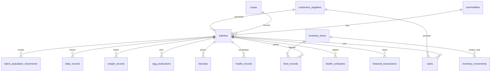

# Database FarmPro

Migrasi dipisah per tahap (jalankan berurutan oleh `php artisan migrate`):

| File | Tabel |
|---|---|
| 000001 master | farm_profiles, users (+role, farm_profile_id), commodities, coops, customers_suppliers |
| 000002 batch | batches, batch_population_movements |
| 000003 operasional | daily_records, feed_records, weight_records, egg_productions, harvests |
| 000004 kesehatan & stok | inventory_items, inventory_movements, health_records, health_schedules |
| 000005 keuangan & sistem | sales, expenses, financial_transactions, budget_simulations, farm_notifications, audit_logs |

## Aturan penting
- `batches.current_population` hanya diubah `PopulationService` (mutasi: death, cull, harvest, transfer_in/out).
- Uang/bobot/kuantitas = `DECIMAL`, bukan FLOAT. Soft delete pada master dan transaksi penting.
- Pembelian barang → 1 `inventory_movements` + 1 `financial_transactions` (expense). Pemakaian pakan → stok turun, biaya masuk `feed_records.cost`, **tanpa** pengeluaran kas kedua.
- `financial_transactions` adalah sumber tunggal dashboard; `type=transfer` tidak masuk laba-rugi; koreksi memakai reversal (`reversed_of_id`).
- Tabel notifikasi bernama `farm_notifications` agar tidak bentrok dengan tabel `notifications` bawaan Laravel.
